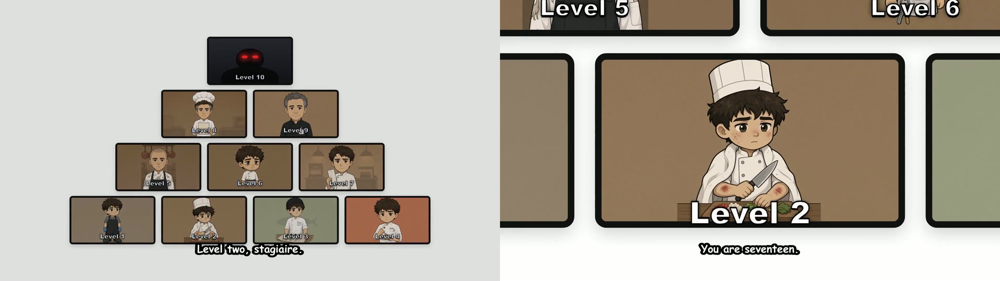
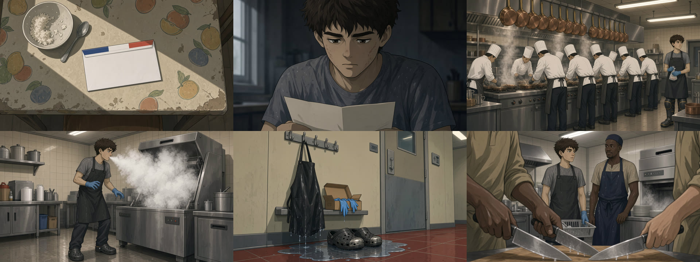

# Machine « POV » pour Agent OS

Une usine à vidéos YouTube **« Your Life as Every Rank in … »** : des documentaires dramatisés à la deuxième personne où *tu* entres au bas d'une hiérarchie à 17 ans et la montes **niveau par niveau jusqu'au sommet** — armée nord-coréenne, cartel, Légion étrangère, cuisine étoilée, équipage pirate, Templiers… Le format de la chaîne POVrank, reconstruit à partir de 24 vidéos décortiquées.

**Tu donnes une organisation à gravir et une durée. La machine rend la vidéo 1080p et tout le nécessaire pour la poster** : script en 10 niveaux, voix off, un protagoniste dessiné qui vieillit d'un niveau à l'autre, la pyramide de rangs à chaque changement de niveau, sous-titres incrustés, présentateur du CTA, miniature au code de la niche, titre, description et tags.





**Coût mesuré : environ 4,20 $ pour 14 minutes de vidéo** (154 images à 0,02 $ = 3,10 $, voix + transcription 0,86 $, cartes de la pyramide 0,18 $, référence 0,02 $) — comptez ~7 $ pour les 25 minutes du format de la niche. Durée : de l'ordre de 1 h 45 de bout en bout en mode automatique (les images et le montage font l'essentiel).

---

## Ce que la machine fabrique

| Étape | Ce qui se passe |
|---|---|
| **Sujet** | Tu tapes l'organisation (« the French Foreign Legion », « a Michelin-starred kitchen »), ou 💡 propose une idée tirée des titres les plus vus de la niche. |
| **Script** | Un **outline** en un appel (titre à la formule, protagoniste, 10 rangs avec leur nom natif, l'âge, la tenue, un beat unique, des personnages secondaires nommés et un mot d'évaluation, la chute), puis les **10 niveaux écrits en parallèle** (~375 mots chacun à 150 mots/min), persistés au fil de l'eau. Hook = la première phrase du niveau 1, sans intro ; dernière phrase courte et sèche. |
| **Voix** | Inworld TTS **niveau par niveau** + le CTA fixe de la niche inséré après le niveau 3, concaténés avec les offsets réels, puis **Whisper mot à mot** : les plans sont découpés **sur le sens**, jamais sur l'horloge (~5,5 s par plan ; les 3 premières secondes de chaque niveau sont réservées à la pyramide). |
| **Protagoniste** | Une **référence** générée au début (plan moyen, fond neutre) devient l'ancre i2i de **toutes** les images : même visage d'un plan à l'autre, qui **vieillit et change de tenue** à chaque niveau. |
| **Pyramide** | 9 portraits chibi du protagoniste au rang de chaque niveau (le sommet reste une silhouette aux yeux rouges jusqu'à la fin), disposés 4 / 3 / 2 / 1 ; à chaque changement de niveau, pyramide entière puis **zoom** sur la carte du niveau — rendu Remotion en MP4, pris sur la narration. |
| **Images** | Kie.ai en image-to-image (Grok Imagine 2 par défaut ; Nano Banana 2 Lite, Seedream 5 Lite ou GPT Image 2 au choix), style 2D webtoon désaturé martelé, plans variés (moyen, large, objet, visage), 5 en parallèle. Un prompt refusé par la modération est **réécrit en version implicite** et relancé aussitôt. |
| **Montage** | FFmpeg : clips zoompan 1920×1080, pyramides, concat, sous-titres gravés (police arrondie blanche à contour noir, ≤ 7 mots), présentateur du CTA + bouton d'abonnement animé (Remotion), mux de la voix. |
| **Packaging** | Titre « Your Life as Every Rank in … », description au code de la chaîne + disclaimer IA, tags, et **miniature « Odd Dude »** : rang 1 apeuré à gauche, rang 10 triomphant à droite, zéro texte — ancrée sur les miniatures concurrentes les plus vues. Puis Stock et publication YouTube (manuelle ou automatique). |


| Cuisine étoilée | Templiers | Équipage pirate |
|---|---|---|
|  |  |  |

Tout est **reprenable** : un run interrompu repart là où il s'est arrêté, chaque étape se relance seule, chaque niveau est éditable avant la voix, chaque image, chaque carte et la référence se régénèrent individuellement sans perdre le reste.


---

## Installation (2 minutes)

**Le plus simple : donne ce dépôt à ton LLM** (Claude Code, Codex, Cursor…) avec cette phrase :

> Installe la machine POV dans mon Agent OS en suivant le fichier INSTALL-LLM.md de ce dépôt : https://github.com/Alex-sia99/pov-machine

**À la main :**

```bash
git clone https://github.com/Alex-sia99/pov-machine
cd pov-machine
node install.js /chemin/vers/ton-agent-os     # le dossier qui contient agent-os/ et remotion/
                                             # ajoute --dry pour simuler sans rien écrire
```

L'installateur copie les fichiers puis pose lui-même les branchements dans `server.js`, `index.html`, `core.js`, `machines.js` et `Root.tsx`. Il est **idempotent** (relançable sans rien dupliquer), garde une sauvegarde `.bak-pov` de chaque fichier modifié, respecte les fins de ligne du fichier, et liste les rares branchements à faire à la main si ton Agent OS diffère.

### Ensuite

1. **Coffre d'Agent OS** : `kie` (images) et `fal` (voix Inworld + Whisper). **Google Drive connecté** (la référence du protagoniste et la voix sont lues par Kie et FAL via une URL publique). Une chaîne YouTube si tu veux publier depuis la machine.
2. `cd remotion && npx remotion compositions` → `PovPyramid` et `StickmanCta` doivent apparaître.
3. Redémarre Agent OS → **Machines → 🔺 POV** → une organisation, la durée, le nombre de niveaux → **⚙ Générer**. Premier essai conseillé : 3 minutes, 4 niveaux, en Semi-manuel (~0,90 $).

---

## Réglages

**À chaque vidéo** : l'organisation, la durée (3 à 35 min, 25 par défaut), le nombre de niveaux (4 à 12, 10 par défaut), la langue et la voix Inworld, les sous-titres, le mode Semi-manuel (relecture du script, de la voix et des images) ou Automatique, la publication.

**Paramètres** : modèle d'images, niveaux et durée de plan par défaut, langue de la chaîne (titre, description, tags), confidentialité à la publication, banque de niche liée, nom de chaîne sur le bouton d'abonnement, présentateur du CTA (asset partagé, régénérable).

Le CTA après le niveau 3 et la pyramide à chaque niveau sont **fixés par la recette de la niche** : ce sont les codes mesurés sur les 24 vidéos, pas des options.

---

## La recette de la niche

[`agent-os/docs/RECETTE-NICHE-POV.md`](files/agent-os/docs/RECETTE-NICHE-POV.md) — tout ce que la machine encode, chiffré : durée médiane 25 min, ~3 800 mots à ~150 mots/min, 10 niveaux de ~2 min 20, un seul CTA juste après le niveau 3, une image toutes les ~5 s, 1,5 à 3 chiffres par 100 mots, « you » 4 à 6 fois par 100 mots ; la structure narrative invariante (formule d'ouverture de chaque niveau, rang nommé dans sa langue d'origine, scène humaine avec un personnage secondaire nommé, dilemme moral, mot d'évaluation, fil rouge, niveau 10 = sommet et chute) ; le système visuel relevé image par image (pyramide 4/3/2/1, silhouette du sommet, style 2D webtoon désaturé, présentateur sur fond orange) ; le code des miniatures et des titres ; et ce qui fait monter les vues (les organisations fermées, secrètes ou redoutées — la hiérarchie à gravir est le moteur, pas le thème).

Comment elle a été écrite : 24 vidéos de la chaîne POVrank scrappées (métadonnées, transcripts, vision), sous-titres horodatés des 24, décorticage image par image de 2 vidéos et planches-contact des 24 miniatures — puis traduction de chaque mesure en réglage ou en prompt de la machine.

---

## Contenu du dépôt

```
files/agent-os/lib/machines/pov.js           le moteur de la machine (machine à états reprenable)
files/agent-os/lib/machines/pov.export.json  le manifeste (fichiers, prérequis, pipeline, branchements)
files/agent-os/public/js/pages/pov.js        l'interface (Générer, Runs, Stock, Paramètres + wizard)
files/agent-os/docs/RECETTE-NICHE-POV.md     la recette de la niche, chiffrée
files/remotion/src/PovPyramid.tsx            la pyramide de rangs (pyramide entière → zoom sur le niveau)
if-missing/remotion/src/StickmanCta.tsx      le bouton d'abonnement animé (copié seulement s'il manque)
server-routes.snippet.js                     le bloc de routes, si tu préfères l'installer à la main
install.js                                   l'installateur
INSTALL-LLM.md                               le guide pas à pas pour l'assistant IA qui installe
```

La machine s'appuie sur le socle d'Agent OS, qui n'est pas dupliqué ici : `store`, `claude`, `vault`, `fal`, `ffmpeg`, `google`, `tasks`, `spend`, `bank`, `scrap`. L'installateur vérifie leur présence et le dit clairement s'il en manque un. La machine n'ajoute **aucune dépendance npm**.

## Services utilisés

| Service | Rôle |
|---|---|
| Claude Code (CLI connecté à Agent OS) | outline, niveaux, prompts d'images, packaging, idées |
| FAL.ai | voix Inworld TTS (par niveau), Whisper mot à mot |
| Kie.ai | référence du protagoniste, cartes de la pyramide, images de scène, miniature |
| Remotion 4 | pyramide de rangs (MP4), bouton d'abonnement (séquence PNG) |
| FFmpeg | clips zoompan, concat, sous-titres, overlay CTA, mux |
| Google Drive | URLs publiques pour Kie (i2i) et FAL (Whisper) |
| YouTube | publication depuis le Stock (facultatif) |
